# SceneGap Edge

**Helps a crew check the shot list against the footage before leaving the location, with playable evidence and a person's decision on every shot.**

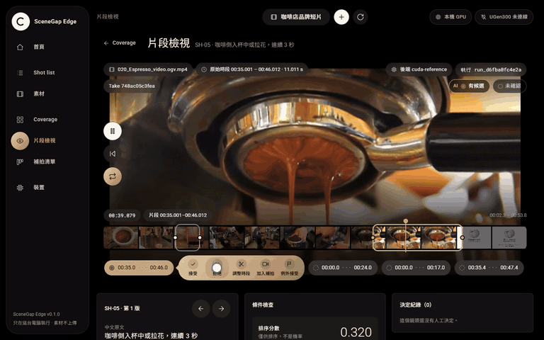

*Evidence view, real time (trimmed). The first candidate for SH-05 "coffee or latte art poured into a cup, 3 s" is an espresso stream
with no cup, so it is rejected with the reason "No cup in frame"; the latte-art pour is then accepted.*

[Demo video (YouTube)](https://youtu.be/CFYIqu2dkiM) ·
[Project page](https://yu9bryan.github.io/scenegap-edge/) ·
[Proposal deck (PDF)](docs/deck/SceneGapEdge_StageI_Proposal.pdf) ·
[Evaluation report](eval/results/REPORT.md) ·
[中文說明](README.zh-TW.md)

SceneGap Edge is a review assistant for small video crews and freelance editors. You write the shot list ("3 s of
latte being poured", "two takes of the barista", "readable brand on the bag"). SceneGap indexes the footage on your
own computer, finds candidate clips with original timecodes, checks each rule (length, takes, same frame) and shows
pass, fail or can't tell with the clip to play. A person decides every shot; shots without a usable clip go on a
reshoot list. An opt-in check layer also flags shots that look missing: on a preregistered test of 150 new photo
clips it caught 65% of missing shots at 3.8% wrong reshoot calls (see results).

Built by rm-rf-1 for the ASUS UGen AI League (Creator AI, Lightning track), intended for the ASUS UGen300 USB AI
accelerator with Hailo-10H.

## Contents

- [The problem](#the-problem)
- [How it works](#how-it-works)
- [Walkthrough](#walkthrough)
- [Measured results](#measured-results)
- [What is done and what is not](#what-is-done-and-what-is-not)
- [Quick start](#quick-start)
- [Configuration](#configuration)
- [API](#api)
- [Repository layout](#repository-layout)
- [Validation process](#validation-process)
- [Hardware plan: UGen300](#hardware-plan-ugen300)
- [Security and privacy](#security-and-privacy)
- [Testing and rerunning the evaluation](#testing-and-rerunning-the-evaluation)
- [Roadmap (Stage II)](#roadmap-stage-ii)
- [Footage credits](#footage-credits)
- [Licence](#licence)
- [中文摘要](#中文摘要)

## The problem

A two-person crew shoots a 60-second café promo in one afternoon. They pack up at 17:40. At 23:00 the editor finds
that the pour cuts away after two seconds and nobody filmed a customer drinking. By then the location is gone.

Editing tools can already search footage by content: Premiere Pro (Media Intelligence, 2025; matches come back as
In/Out ranges inside a clip), DaVinci Resolve 21 (IntelliSearch) and Final Cut Pro 12 (Visual Search) all do. Their
official documentation does not describe checking a shot list: how long a shot must run, how many takes, what must
be in the same frame. The one tool we found that compares
footage with a shot list (invideo's AI script supervisor) works on uploads and publishes no accuracy figures. Sources
and dates are in [`docs/research/BUSINESS_FACTS.md`](docs/research/BUSINESS_FACTS.md).

SceneGap does that check on the laptop at the location, without uploading anything, and keeps the final say with a
person.

## How it works

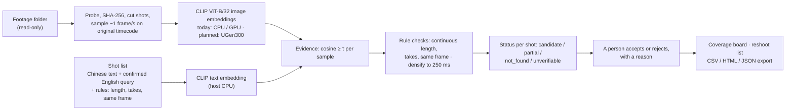

1. **Shot list.** Each shot is written in Chinese by the user, with an English retrieval query a person confirms
   (`query_en`, [ADR-003](docs/adr/ADR-003-chinese-queries.md)), plus rules: minimum continuous length, minimum
   takes, what must appear together. Every edit creates a new revision; results for the old revision become
   `outdated` and are never silently reused.
2. **Media.** Probe first, hash every file (SHA-256; a duplicate becomes an extra location, not a second take), cut
   shots, and sample about 1 frame per second on the original presentation timestamps. Times are half-open
   intervals in milliseconds of the original timeline. Rotation, variable frame rate and start offsets are handled.
3. **Evidence.** CLIP image embeddings per sample; a text query passes a sample when cosine ≥ τ. τ is calibrated on
   the dev split per model fingerprint and then frozen. Without a calibration file, analysis answers `UNCALIBRATED`
   instead of guessing a threshold.
4. **Rule checks.** Consecutive passing samples in one shot form a run. Duration uses conservative bounds (lower =
   span of passing samples; upper = up to the neighbouring failing samples or the shot edges). When the bounds cannot
   decide, the window is re-sampled every 250 ms. Co-occurrence needs all queries in the same frame. Takes are
   counted by capture, so a copied file is not a second take.
5. **Three-valued logic.** Each check returns pass, fail or unknown, and unknown is never treated as pass. Actions,
   readable text and composition are manual in this version: the system ranks where to look and a person decides
   ([ADR-004](docs/adr/ADR-004-actions-and-ocr-manual-first.md)).
6. **Status.** The automatic status is one of `candidate`, `partial`, `not_found`, `unverifiable`, `failed`,
   `not_analyzed`; it is never "done". `not_found` means nothing reached τ in the analysed scope, not proof of
   absence. Human decisions (`accepted`, `rejected`, `overridden` with a reason) are stored separately, and the latest
   decision on a segment wins. Coverage shows the human-confirmed share and the AI-candidate share separately.
7. **Reshoot list.** Shots with no usable segment, or that a person sends there, become reshoot cards with the reason,
   the minimum length and the best candidate so far. Adding a clip later analyses only the new file.

Details with file and line references: [`docs/ALGORITHMS.md`](docs/ALGORITHMS.md). Model and hardware plan:
[`docs/MODEL_PLAN.md`](docs/MODEL_PLAN.md).

## Walkthrough

The UI is in Traditional Chinese. Everything below is the real app on openly licensed Wikimedia Commons footage, a
café-promo project with the 11 shots from [`eval/requirements.json`](eval/requirements.json). The GIFs are cut from
the live screen recordings made for the demo video (desktop GPU).

### 1. Write the shot list

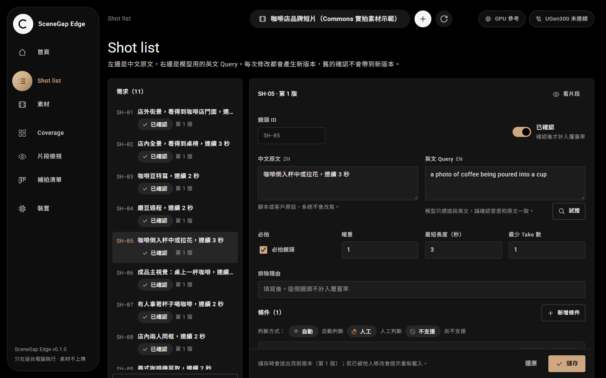

*Shot list (Shot list). Left: the 11 shots, each marked 已定稿 (finalised) with its revision (第 1 版 = revision 1).
Right: SH-05 "咖啡倒入杯中或拉花，連續 3 秒" (coffee poured into a cup or latte art, 3 s continuous), with the English
query the model reads. 試搜尋 runs a test search; saving creates a new revision.*

### 2. Import footage and analyse

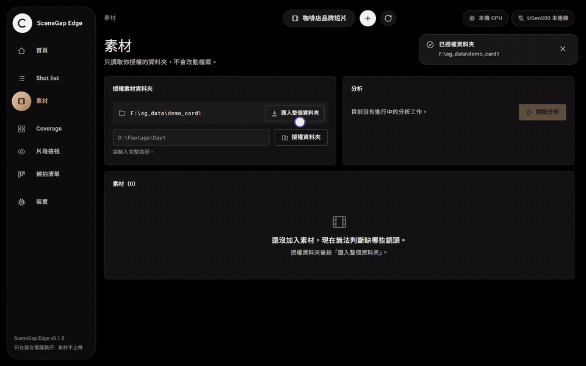

*Assets (素材), sped up: import 2×, analysis about 6×. The folder is authorised (授權資料夾), 8 clips are imported
(匯入整個資料夾) and analysis starts (開始分析). On a desktop GPU the first analysis of these 8 clips took 25.2 s.*

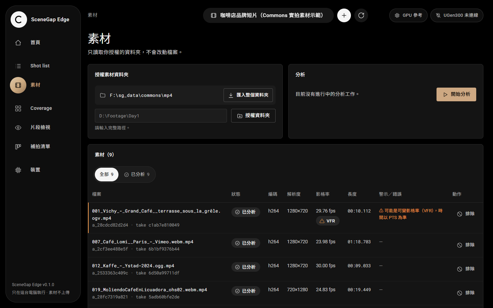

*Assets table: status (已分析 = analysed), codec, resolution, frame rate, length, and warnings. The first clip is
flagged as possibly variable frame rate (VFR); times stay on the clip's original timestamps.*

### 3. Read the coverage board

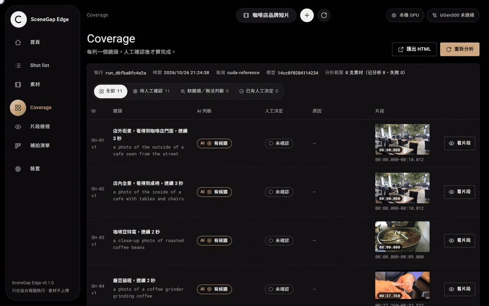

*Coverage board, sped up 1.5×. One row per shot: AI 判斷 (AI answer, e.g. 有候選 = candidate, 部分符合 = partial),
人工決定 (human decision, 未確認 = not yet confirmed), and the best candidate's thumbnail and timecode.*

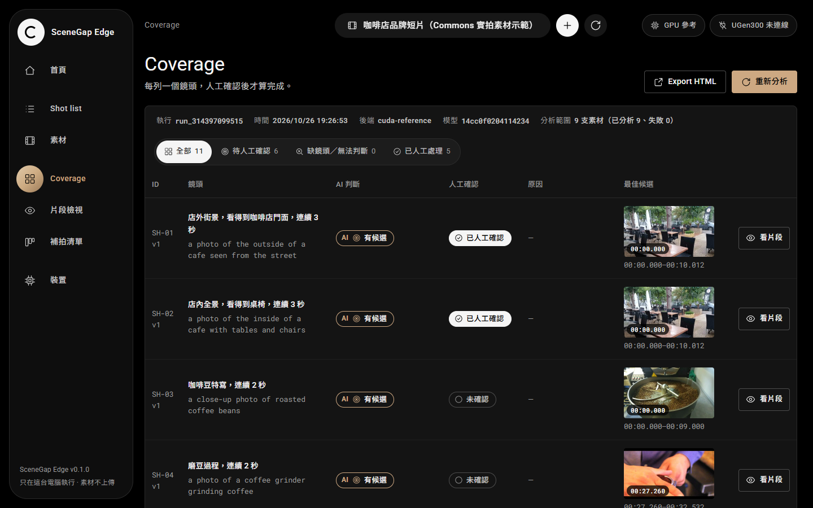

*The same board after review: 已接受 (accepted) in a white pill is a person's decision; the bronze AI pill is the
model's. Filters: all, waiting for a person, missing or undecidable, decided by a person.*

### 4. Review the evidence

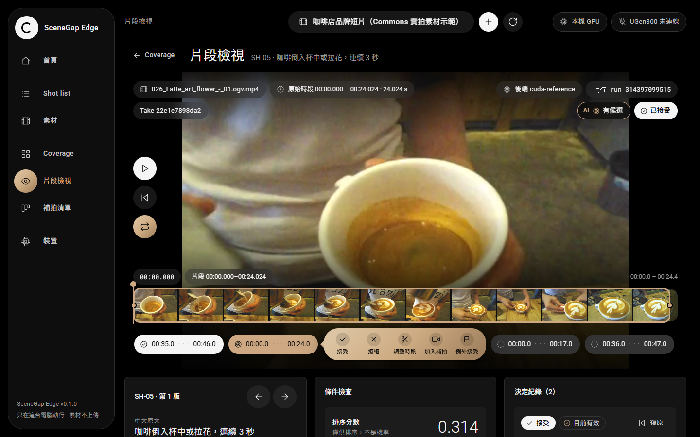

*Evidence view (片段檢視) for SH-05. The candidate plays on its original timecode; the filmstrip shows the sampled
frames and the candidate ranges. Action bar: 接受 accept, 拒絕 reject, 調整時段 adjust range, 加入補拍 add to reshoot
list, 例外接受 accept as exception. The score is labelled 排序分數（非機率）: a ranking score, not a probability.*


*Rule check and decision history: 連續時長 ≥ 3 秒 (continuous length ≥ 3 s) passes with 24.0 s. The history keeps the
rejection with its reason ("only the espresso stream, no cup in frame") and the acceptance; the latest decision on a
segment counts, and 復原 reverts it.*

### 5. Send missing shots to the reshoot list

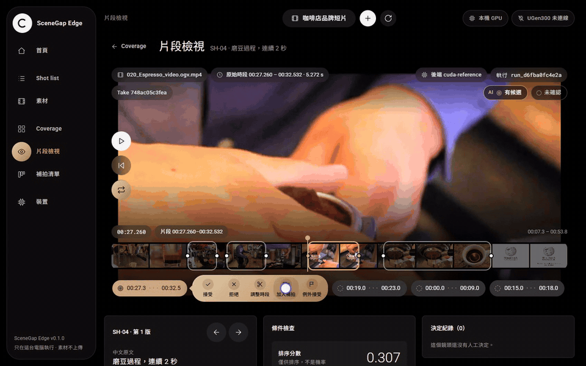

*Real time. The SH-04 candidates show tamping, not grinding, so the shot is added to the reshoot list (加入補拍) with
the reason "Tamping, not grinding. Need 2 s of grounds coming out".*

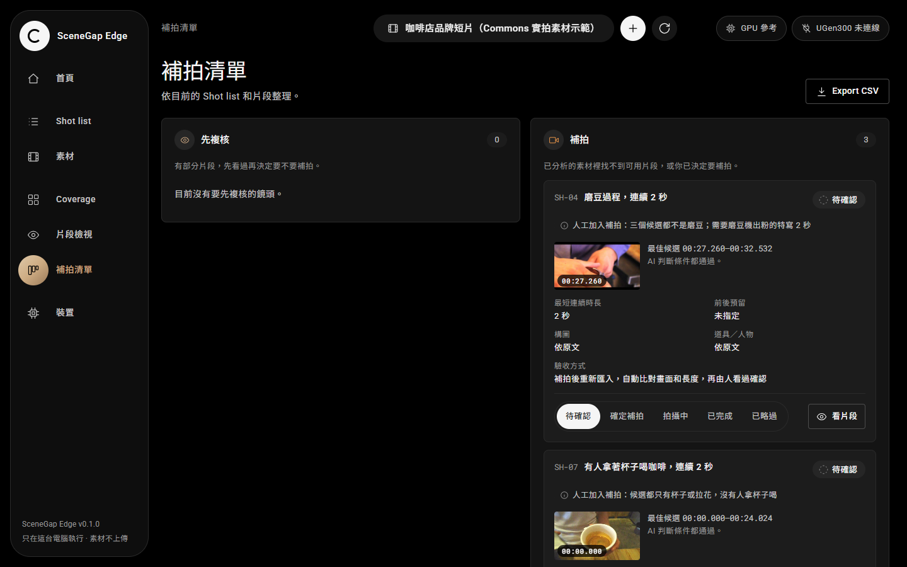

*Reshoot list (補拍清單). 先複核 (review first) holds shots with segments still to check; 補拍 (reshoot) holds shots
with no usable segment or that a person sent there. Each card keeps the reason, the minimum length (最短長度) and the
best candidate so far. 匯出 CSV exports the list.*

### 6. Add the reshot clip

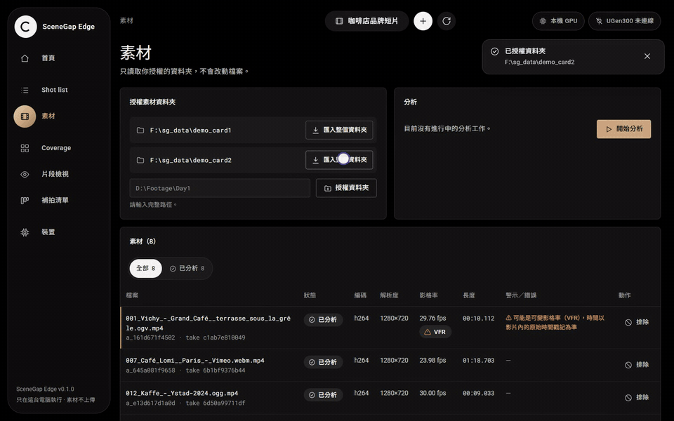

*Sped up (import 3×, evidence 2×, accept 1.5×). One new clip is imported; only that file is analysed. SH-04 now shows
grounds falling from a grinder, the segment is accepted, and the card leaves the reshoot list. On a desktop GPU the
new clip took 2.5 s to analyse.*

### 7. Home and device status

| Home | Device |
|---|---|
| 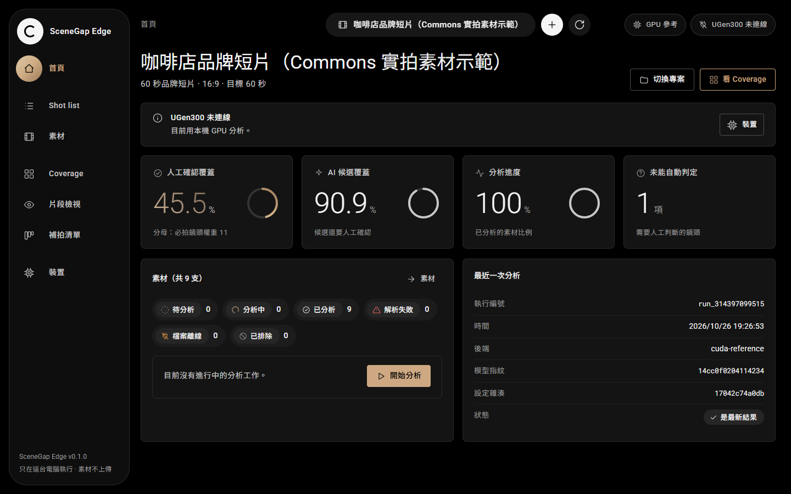 | 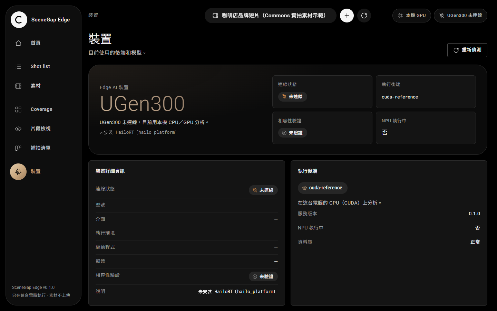 |
| 人工確認覆蓋率 human-confirmed coverage (45.5%) and AI 候選覆蓋 AI-candidate coverage (90.9%) are shown apart; 無法自動判斷 counts shots the system cannot decide. | 裝置 (Device): UGen300 未連線 (not connected), HailoRT not installed, backend `cuda-reference`, NPU active: no. The app never labels a CPU/GPU run as NPU. |

## Measured results

Full numbers, intervals and the per-shot table: [`eval/results/REPORT.md`](eval/results/REPORT.md). Acceptance
trace: [`eval/results/ACCEPTANCE.md`](eval/results/ACCEPTANCE.md). Process, in Chinese:
[`docs/VALIDATION_zh.md`](docs/VALIDATION_zh.md).

<!-- RESULTS:BEGIN -->


**Measured so far** (44 openly licensed Wikimedia Commons clips, 25 min; held-out test split of 26 clips scored once;
CLIP ViT-B/32 on a desktop GPU/CPU; full numbers in [`eval/results/REPORT.md`](eval/results/REPORT.md)):

| | Result |
|---|---|
| Retrieval, top 5 per shot | Right clip in the top 5 for 7 of 11 shots (Hit@5 64%, Precision@5 33%). Plain single-frame search: 8 of 11 (73% / 40%); title keywords 45% / 36%. The lost hit is a ranking issue (runs ranked by average, not peak similarity), not a rule rejection |
| Rule checks, controlled cases | 10 of 12 judged right (length, same frame, takes; real footage cut to a known answer). Misses: a finished latte passes as a pour; a re-encoded copy counts as a second take |
| Finding missing shots automatically | Test 1 (CLIP only): 0 of 38. Test 2 (Qwen2-VL-2B checks the top 3 candidates, Stage 1.5): 32 of 91 caught at 3 of 41 wrong reshoots (7.3%). **Test 3** (39 new clips, scored once; the check layer asks each shot's check question for every second and needs 2 confirmed seconds, Stage 1.6): 76 of 152 caught (50%) at 8 of 68 wrong reshoots (12%). Targets: ≥ 30% caught (met), ≤ 5% wrong reshoots (not met). The misses are borderline frames, so each missing-shot alert shows the 3 most likely frames; if a person recognised every frame that lies in a labelled segment, 2 of 68 would remain (2.9%, defined after test 3; simulated from the labels, not a user test). **Test 4** (150 new Commons photos as 4 s clips, same frozen rule, preregistered, scored once): 146 of 226 caught (65%) at 4 of 104 wrong reshoots (3.8%, 95% CI 1.5–9.5%); both targets met, and with the same simulated 3-frame look 0 of 104 remain (assumes the person recognises the shot; not a user test). Photos have no motion or cuts, so real café video is still the next check. `eval/PROTOCOL.md` |
| Review load (proxy) | Candidate clips add up to 317 s for 11 shots, versus 839 s of footage (footage length, not timed users) |
| Labels | two independent AI annotators, κ = 0.91, AI third pass on 143 disputed frame labels |
| Speed (desktop) | 2.3 s (GPU) / 3.1 s (CPU) of decode + embedding per minute of video (six short clips, ≤1280 px); text search over 10,000 segments p95 13–14 ms |
| Playback while analysing | 0 late frames of 1,800 (synthetic 1080p30 test pattern); frame work p95 5.7 → 7.5 ms (CPU) / 6.2 ms (GPU) |
| UGen300 | not run yet (G1 gate script ready) |
| Tests | 46 automated tests; 30 of 36 PRD acceptance cases pass by test; fresh-environment rebuild passes |
<!-- RESULTS:END -->

### What the model returns

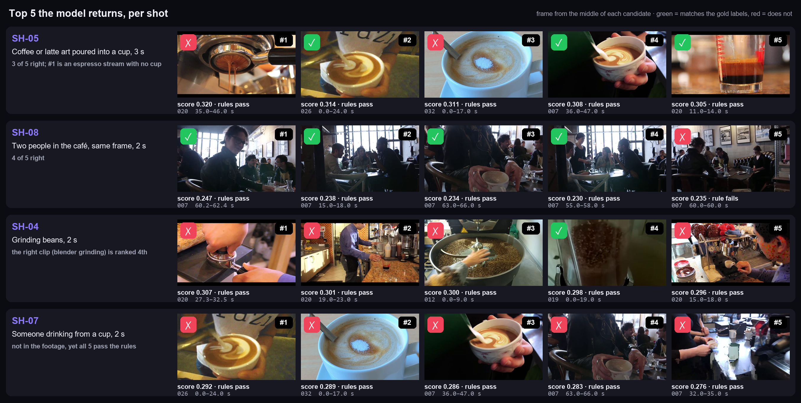

*Demo project (9 Commons clips). SH-05: the right clips are in the list but #1 is an espresso stream with no cup.
SH-04: the right clip is ranked 4th. SH-07 is not in the footage, yet five clips pass the rules, which is why
missing shots go undetected today.*

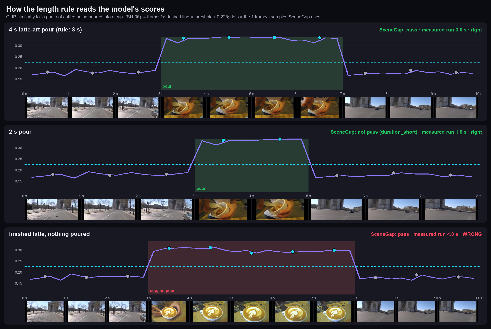

*How the length rule reads the scores: a 4 s pour gives four samples above τ (lower bound 3.0 s, passes the 3 s
rule); a 2 s pour gives 1.0 s (too short); a finished latte scores as high as a pour, so a person checks the action.*

Details behind the table:

- **Retrieval** was scored on the test split (26 clips, 14 min) with frozen settings. The 95% intervals are wide:
  35–85% for SceneGap and 43–90% for single-frame search.
- **Missing shots.** 0 of 38 unavailable shots were reported as `not_found`. A dev-only sweep after the test shows the
  trade-off a new objective must handle: raising τ from 0.225 to 0.29 finds 46% of gaps but wrongly asks for 31% of
  reshoots.
- **Labels.** 472 of 484 clip × shot pairs agree between the two annotators. A consistency pass, added to the protocol
  before calibration, removed 78 of 238 agreed positives; scoring the lenient labels instead leaves the SceneGap and
  single-frame numbers unchanged.
- **Speed** was measured with the RTX 4080 for GPU. At 1 frame per second most of the time goes to decoding, not to
  the model.

## What is done and what is not

| Part | Status |
|---|---|
| Requirement → constraint → evidence → decision pipeline, three-valued logic, coverage, reshoot cards | Implemented, covered by the 46 automated tests |
| Media path: MP4/MOV H.264 8-bit, rotation, VFR, start offsets, corrupt and unsupported files | Implemented, tested on synthetic fixtures |
| Semantic retrieval | OpenAI CLIP ViT-B/32 on host CPU or CUDA (`cpu-reference` / `cuda-reference`) |
| Accuracy | Measured once on a held-out split of openly licensed Commons clips (not self-shot), AI-annotated |
| Automatic missing-shot detection | Opt-in check layer (`python -m scenegap --verifier`): on test 4 (still photos) 65% of missing shots caught at 3.8% wrong reshoots, both targets met; on test 3 (video) 50% at 12%. Each alert shows 3 frames for a person to rule out (0 of 104 left on test 4, simulated from the labels; not a user test). Not yet shown on real café video |
| Rule checks | 10 of 12 controlled cases right (`eval/rule_check.py`); a person still checks the action itself |
| Platforms | Tested on Windows 11. UGen300 supports Windows, Linux and Android (no macOS listed); on a Mac SceneGap runs on CPU only |
| UGen300 / Hailo-10H | Not run. Device check only; the Hailo backend refuses to run until the G1 gate passes on a real device |
| Actions, readable text, composition | Manual: the system ranks where to look, a person decides |
| Chinese queries | Through a person-confirmed English query; a multilingual encoder is a Stage II experiment |
| User study, power measurement, NLE timeline interference | Not done. A playback-interference proxy is in `eval/interference.py` |

## Quick start

Requirements: Python 3.10 or newer (CI runs 3.10 and 3.12). The first start downloads the CLIP weights
(`openai/clip-vit-base-patch32`) from Hugging Face; after that the core flow works offline.

```bash
python -m pip install -r requirements-ml.txt
python -m scenegap --workdir ./sg_work
```

For CUDA, install the PyTorch build for your platform first (see pytorch.org), then the line above.

Open the printed address (`http://127.0.0.1:8765/`). Then:

1. Create a project (the round + button at the top) and write the shot list; `eval/requirements.json` has the 11
   example café shots.
2. On 素材 (Assets), authorise a footage folder by its full path and import it.
3. Start the analysis (開始分析), then work through the coverage board and the evidence view.

The service binds to this computer only and creates a new session token on every start.

### Docker (CPU)

```bash
docker build -t scenegap-edge .
docker run --rm -p 127.0.0.1:8765:8765 -v "$PWD/footage:/footage:ro" -v sg_work:/work scenegap-edge --host 0.0.0.0
```

The footage is mounted read-only at `/footage`; authorise `/footage` in the app. The port is published to
127.0.0.1 only. The image includes `eval/results/calibration.json`.

## Configuration

### Command-line options

`python -m scenegap` (or the `scenegap` command after `pip install -e .`) accepts:

| Option | Environment variable | Default | Meaning |
|---|---|---|---|
| `--workdir` | `SG_WORKDIR` | `./sg_work` | SQLite database, embedding index and job state |
| `--port` | `SG_PORT` | `8765` | Local port |
| `--device` | `SG_DEVICE` | CUDA when available, else CPU | `cpu` or `cuda` for the reference backend |
| `--calibration` | `SG_CALIBRATION` | `eval/results/calibration.json` | Threshold file (below) |
| `--host` | | `127.0.0.1` | Keep the default; only change it inside a container |

### Calibration file

[`eval/results/calibration.json`](eval/results/calibration.json) holds the threshold chosen on the dev split:
`fingerprint` (the model fingerprint, `14cc0f0204114234`), `crop` (`center-crop`) and `chosen.tau` (0.225), plus the
model manifest and the dev F1. At start the service maps that fingerprint to τ. If the file is missing, or the
loaded model has a different fingerprint, search and analysis answer `UNCALIBRATED`. A new model, quantization or
preprocessing gets a new fingerprint and needs its own dev calibration (`eval/evaluate.py calibrate`).

## API

All routes are under `/api/v1` and served on 127.0.0.1 only. Every request except `/health` needs the per-run token
in the `X-SG-Token` header; the token is embedded in the page served at `/`. Video and frame requests from `<video>`
and `` may use an HttpOnly, SameSite=Strict cookie instead. Requests with a foreign `Origin` or `Host` are
refused. Errors always use one shape: `{code, message, recoverable, stage, asset_id, request_id}`. The interactive
schema is at `/docs` (FastAPI).

| Method and path | Purpose |
|---|---|
| `GET /health` | Service, version, active backend, device availability (no token) |
| `GET /device/status` | UGen300 / Hailo detection and the active model manifest |
| `GET /projects`, `POST /projects` | List or create projects (`name`, `purpose`, `aspect`, `target_len_s`) |
| `GET /projects/{pid}` | Project with asset counts by status and authorised roots |
| `POST /projects/{pid}/roots` | Authorise a footage folder (`path`) |
| `GET /projects/{pid}/requirements`, `POST …/requirements` | List or add shot-list requirements |
| `PATCH /projects/{pid}/requirements/{rid}` | Edit a requirement; needs `expected_revision`, answers 409 when stale |
| `POST /projects/{pid}/assets/import` | Import files from an authorised root (`root_id`, optional `rel_paths`) |
| `GET /projects/{pid}/assets` | Assets with probe data, hash, status and locations |
| `POST /projects/{pid}/assets/{aid}/exclude` | Exclude an asset (reason required) |
| `POST /projects/{pid}/analyze` | Queue analysis (202, returns `job_id`, backend and model fingerprint) |
| `GET /jobs/{jid}`, `POST /jobs/{jid}/cancel`, `GET /projects/{pid}/jobs` | Job progress, cancel, list |
| `GET /projects/{pid}/coverage` | Coverage view: per-shot AI status, candidates, human decisions, ratios |
| `POST /projects/{pid}/search` | Free text search (`query_en`, `top_k`); scores are similarities, not probabilities |
| `POST /projects/{pid}/review` | Record a decision on a segment (`accepted`, `rejected`, `overridden`; with a reason) |
| `GET /projects/{pid}/decisions` | Decision history |
| `GET /projects/{pid}/reshoots` | Reshoot and review-first cards |
| `POST /projects/{pid}/reshoots/{rid}/request`, `…/status` | Send a shot to the reshoot list; update its status |
| `GET /projects/{pid}/exports/{fmt}` | Export `json`, `csv` or `html` |
| `GET /assets/{aid}/media`, `GET /assets/{aid}/frame?t_ms=` | Stream the original file (HTTP Range) or one frame as JPEG |

## Repository layout

```
scenegap/          the service
  domain/          three-valued logic, coverage, reshoot cards, data models
  media/           probe (PyAV), synthetic test fixtures
  shots/           decode, cut detection, sampling, quality flags
  backends/        CLIP reference backend (CPU/CUDA), Hailo device check and gated backend
  store/           SQLite storage, job runner
  export/          CSV / HTML / JSON reports
  api/             FastAPI app (routes above)
  service.py       analysis, run computation, densify, decisions
  __main__.py      command line entry point
web/               single-page UI (vanilla JS, no build step)
eval/              protocol, shot list, labels, adjudication, evaluation, G1 harness, results
scripts/           Commons download and transcode, contact sheets, acceptance trace, clean-env rebuild
datasets/manifests clip list with source, licence, author and hashes (no footage)
docs/              algorithms, model plan, ADRs, validation, research, UI design, screenshots, GIFs, deck, video script
site/              GitHub Pages project page (static)
tests/             unit, integration (real media fixtures), API
```

## Validation process

The full timeline, in Chinese, is in [`docs/VALIDATION_zh.md`](docs/VALIDATION_zh.md). In short:

1. **Rules before data.** [`eval/PROTOCOL.md`](eval/PROTOCOL.md) was committed before any label or threshold
   existed. The 11 café shots in [`eval/requirements.json`](eval/requirements.json) were written before any frame
   was seen. One addition was made after labelling and before calibration and test scoring (the consistency pass,
   19:17); it is marked in the protocol. Check the order with `git log -- eval/PROTOCOL.md`.
2. **Footage.** 44 Wikimedia Commons clips (25.3 min; CC0, public domain, CC BY, CC BY-SA), transcoded once to H.264
   MP4 at most 1280 px wide. The set deliberately includes negatives: tea, beer, sparkling wine, empty cups, street
   scenes, a bar, a park. [`datasets/manifests/commons_manifest.json`](datasets/manifests/commons_manifest.json)
   records the source, licence, author and two SHA-256 hashes per clip.
3. **Split by author**: dev 18 clips, test 26 clips. One author pair has a clip on each side (022 dev, 025 test)
   because their two author strings differ by one space; this was found after scoring and left as is, since the test
   is scored once.
4. **Labels.** Two independent AI annotator sessions on 1 fps contact sheets, blind to each other and to system
   output; a third AI pass on every disagreement wrote 8 rules for cases the guide left open; a consistency pass
   applied those rules to the agreed positives of four shots and removed 78 of 238. Raw labels are kept in
   `eval/labels/raw/`; a lenient gold without the consistency pass is scored alongside.
5. **Calibration on dev only.** Two crop policies were compared; `center-crop` with τ = 0.225 (dev F1 0.240) was
   frozen with model fingerprint `14cc0f0204114234`.
6. **Test scored once** with an ablation (title keywords → single-frame semantic → full system) and Wilson 95%
   intervals. [`eval/evaluate.py`](eval/evaluate.py) refuses a second test run.
7. **After the test, dev only.** [`eval/explore_dev.py`](eval/explore_dev.py) explains the 0% gap recall without
   touching the test result.

## Hardware plan: UGen300

Target device (vendor specification): ASUS UGen300, Hailo-10H, 40 TOPS INT4 / 20 TOPS INT8, 8 GB LPDDR4, USB 3.1 Gen2
Type-C (10 Gbps), 2.5 W typical. Nothing has run on it yet; every NPU number in this repository is `not_run`.

**Route A** ([ADR-002](docs/adr/ADR-002-hailo-route-a.md)): run only the CLIP ViT-B/32 image encoder on the UGen300,
using the Hailo Model Zoo HEF `clip_vit_b_32_image_encoder` (same OpenAI checkpoint as the reference; the vendor lists
81.5 FPS at batch 1 and 350 FPS at batch 8, measured over PCIe, not USB). The text encoder stays on the host CPU with
the same fp32 weights, so quantization error sits on one side only. The host keeps decoding, cut detection, rule
checks and status. At 1 frame per second most of the time is host decoding, so the NPU mainly frees the editing
machine's CPU and GPU rather than shortening the total time.

**G1 gate** ([`docs/MODEL_PLAN.md`](docs/MODEL_PLAN.md) §4, [`eval/g1_gate.py`](eval/g1_gate.py)): on a real device,
feed the same preprocessed 224×224 dev frames to the fp32 reference and to the HEF, then require

| Check | Pass criterion |
|---|---|
| G1a per-frame cosine, fp32 vs HEF | median ≥ 0.98, 5th percentile ≥ 0.95 |
| G1b Spearman ρ per query over all dev frames | median ≥ 0.95, worst query ≥ 0.85 |
| G1c top-K overlap per query | mean ≥ 0.80 (K = 5), ≥ 0.85 (K = 10) |
| G1d dev Recall@5 / Precision@5, each backend with its own τ | no dev shot lost from the top 5; Precision@5 within 5 points of fp32 |
| G1e status agreement on the dev project simulation | ≥ 90% same status, no new false `candidate` on a true gap |
| G1f throughput over USB, batch 1 and 8, and a 60 s clip end to end | reported as measured, never replaced by vendor figures |

The harness is tested: a self-check between the CPU and CUDA reference backends gives cosine 1.0 and ρ 0.99999
([`eval/results/g1_selfcheck.json`](eval/results/g1_selfcheck.json)), which proves the script, not the device. The
`HailoClip` backend raises `DeviceUnavailable` until a UGen300 identifies as HAILO10H and G1 passes; a Hailo run gets
its own fingerprint and its own τ. If G1 fails, the plan is, in order: recompile with dev frames as the calibration
set; keep the last layers at 16-bit if the compiler allows it; switch to TinyCLIP-61M with a new reference; otherwise
ship on the CPU/GPU reference and report the failed G1 with its numbers.

## Security and privacy

- Binds to 127.0.0.1; a random token per run, sent in a header (media requests may use an HttpOnly SameSite=Strict
  cookie).
- Origin and Host checks against DNS rebinding.
- Footage is read only from folders you authorise, by relative path inside them; paths that leave the root are
  refused.
- Nothing is uploaded. The core flow makes no outbound connection (tested, TC-019); only the first model download
  needs the network.
- Originals are never modified (tested, TC-024).
- CSV exports neutralise spreadsheet formulas; HTML exports escape all text.
- Errors never send a traceback to the browser; details stay in the local log and database.

## Testing and rerunning the evaluation

Tests need no model download; the test backend is a colour-statistics mock that only proves state handling.

```bash
python -m pip install -r requirements-dev.txt
python -m pytest -q                      # 46 tests: unit, integration on synthetic media, API
python scripts/acceptance.py             # reruns the tests and rewrites eval/results/ACCEPTANCE.md
bash scripts/clean_env.sh                # fresh venv from the public index, then the full suite (TC-035)
```

To rerun the evaluation you need the footage and the ML requirements (`requirements-ml.txt`). Commands use bash syntax:

```bash
# 1. Rebuild the 44 clips from the manifest (writes the new manifest elsewhere, so the committed one stays intact)
python -c "import json; m=json.load(open('datasets/manifests/commons_manifest.json', encoding='utf8')); json.dump(m['clips'], open('candidates.json', 'w', encoding='utf8'))"
python scripts/fetch_commons.py candidates.json ./sg_data/commons --manifest ./sg_data/commons/manifest.json --max_mb 5000
python scripts/verify_transcodes.py ./sg_data/commons     # durations and mp4 hashes vs the manifest; rewrites datasets/manifests/transcode_check.json

# 2. Calibrate on dev and score test into a separate folder (the committed test result is frozen)
SG_EVAL_RES=./sg_data/rerun python eval/evaluate.py calibrate --mp4 ./sg_data/commons/mp4 --work ./sg_data/eval
SG_EVAL_RES=./sg_data/rerun python eval/evaluate.py test      --mp4 ./sg_data/commons/mp4 --work ./sg_data/eval
SG_EVAL_RES=./sg_data/rerun python eval/evaluate.py perf      --mp4 ./sg_data/commons/mp4 --work ./sg_data/eval

# 3. Optional: G1 harness self-check, playback-interference proxy, dev-only gap analysis
python eval/g1_gate.py --mp4 ./sg_data/commons/mp4 --candidate cuda --self-check
python eval/interference.py --mp4 ./sg_data/commons/mp4 --work ./sg_data/interf
python eval/explore_dev.py --mp4 ./sg_data/commons/mp4 --work ./sg_data/eval
python eval/report.py                    # renders eval/results/REPORT.md from eval/results/*.json
```

`--device` defaults to `cuda` in `eval/evaluate.py`; pass `--device cpu` without a GPU. The steps in group 3 write
into `eval/results/`. A different ffmpeg or x264 build may produce different transcode hashes; the original-file
hashes in the manifest identify the source either way.

## Roadmap (Stage II)

From [`docs/MODEL_PLAN.md`](docs/MODEL_PLAN.md) §8; each step has a measurable exit criterion.

| Step | Work | Exit criterion |
|---|---|---|
| S2-0 | Fix the known code risks listed in `docs/ALGORITHMS.md` §5 | unit test for each; dev numbers recomputed |
| S2-1 | UGen300 bring-up over USB | HAILO10H identified, HEF loads, measured FPS at batch 1 / 8, versions logged |
| S2-2 | G1 on dev | G1a–G1e pass, or a documented failure and fallback |
| S2-3 | Detector hints (YOLOv8s / YOLO11s) for co-occurrence and objects | per-class precision ≥ 0.90, person count ≥ 0.90 on dev |
| S2-4 | Composition from detector boxes | precision ≥ 0.90 on dev composition labels |
| S2-5 | OCR for Traditional Chinese brand text | exact match ≥ 0.90, false-readable ≤ 0.02 on the target script |
| S2-6 | Action aid (optional VLM verifier) | aid: dev Precision@5 of action windows ≥ 0.6; verifier: precision ≥ 0.95 (Wilson lower bound ≥ 0.85) at recall ≥ 0.5, else it stays manual |
| S2-7 | Frozen end-to-end test, run once | Recall@5, Precision@5, gap recall, wrong-reshoot rate, unknown rate with CIs; CPU / GPU / NPU latency and NPU power reported separately |

Missing-shot detection gets its own pre-registered objective: per-shot thresholds and a margin score against negative
prompts, calibrated for project-level gaps rather than frame-level F1, then scored once on new footage. Also planned:
human labels, a user study timing real reviews, a multilingual text encoder for Chinese queries (ADR-003), and an NLE
timeline interference test.

## Footage credits

The evaluation footage and every frame shown in the screenshots, GIFs, deck and video come from 44 openly licensed
Wikimedia Commons clips. The full table with title, author, licence and Commons link is in
[`docs/CREDITS.md`](docs/CREDITS.md). Images that contain frames from CC BY-SA clips keep that licence.

## Licence

Code: Apache-2.0 ([`LICENSE`](LICENSE), [`NOTICE`](NOTICE)). Footage is not included in the repository; each clip
keeps its own Commons licence (CC0, public domain, CC BY, CC BY-SA). The CLIP weights are downloaded at run time
under their own MIT licence. Product names belong to their owners.

## 中文摘要

SceneGap Edge 在你自己的電腦上，把 Shot list（必拍鏡頭清單）和拍到的素材對一次：用 CLIP ViT-B/32 找出候選片段和原始時間碼，檢查長度、Take 數和同框條件，每個鏡頭給出「有候選／部分符合／沒找到／無法判斷」，最後由人接受或拒絕；還缺的鏡頭進補拍清單。素材不上傳。

目前在 44 支 Wikimedia Commons 影片上評測，保留的 test 組只評一次：11 個鏡頭中 7 個的正確片段在前 5 名（單幀搜尋是 8 個）；自動判斷「缺鏡頭」還做不到（0%），是第二階段的主要目標。標註由兩個 AI 標註流程完成（κ 0.91）。UGen300 還沒有實機跑過，G1 檢查腳本已備妥，目前的數字都來自桌機 CPU／GPU。

完整中文說明見 [README.zh-TW.md](README.zh-TW.md)，驗證過程見 [docs/VALIDATION_zh.md](docs/VALIDATION_zh.md)。
